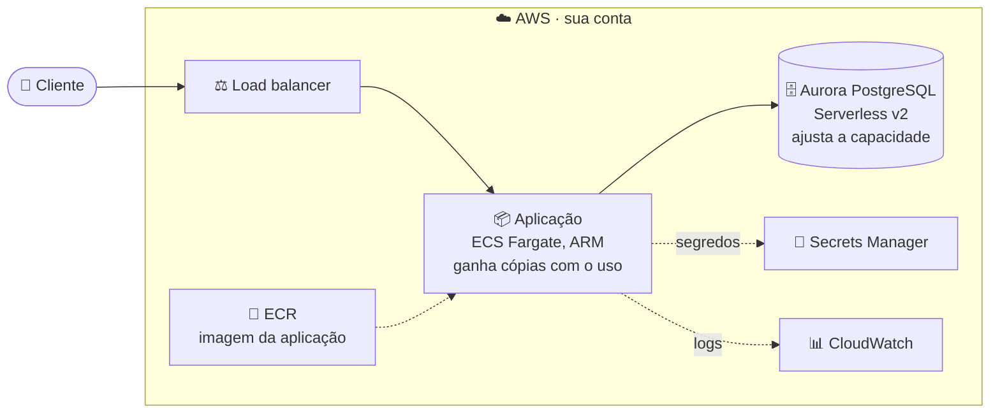

# 🎁 Desafio — Seu projeto no ar na AWS

Durante o workshop, a cada etapa um subagente escreveu a infraestrutura do projeto junto com o código. O desafio é usar essa infraestrutura para colocar o **seu** catálogo no ar na AWS, no ambiente **dev**, com **Terraform** e **Terragrunt**, em serviços que escalam sozinhos.


Tudo roda pelo Docker, como no workshop: você não instala Terraform, Terragrunt nem a AWS CLI. E o Claude pode te guiar em cada passo: subir, entender os recursos e resolver erros.

## ☁️ O que vai para a nuvem



| Peça | Serviço | Por que escala |
| --- | --- | --- |
| Entrada | Application Load Balancer | Distribui as requisições entre as cópias da aplicação |
| Aplicação | ECS Fargate em servidores ARM (Graviton) | Ganha e perde cópias sozinha conforme o uso, sem servidor para administrar |
| Banco | Aurora PostgreSQL Serverless v2 | Aumenta e diminui a capacidade sozinho, sem reiniciar |
| Imagem | ECR | A mesma imagem roda em todo lugar |
| Segredos | Secrets Manager | Chaves fora do código e da configuração |
| Logs | CloudWatch Logs | Para entender o que aconteceu |

A estrutura completa, com dev e prod, está em [`docs/technical/infrastructure.md`](docs/technical/infrastructure.md); as regras, na skill [`infrastructure-as-code`](.claude/skills/infrastructure-as-code/SKILL.md).

## 🎯 Escolha o seu nível

| Nível | Conta na AWS? | Você faz | Custo |
| --- | :---: | --- | --- |
| 🥉 **1. Entender** | Não | Lê a estrutura de dev e prod e roda a validação | Zero |
| 🥈 **2. Planejar** | Sim | Gera o `plan` de dev e entende tudo o que seria criado | Zero |
| 🥇 **3. Subir** | Sim | Sobe dev, abre a URL pública, testa e derruba tudo | ~US$ 3 por dia ligado, coberto pelos créditos |

## 💳 Créditos para contas novas

Contas novas da AWS ganham **até US$ 200 em créditos**: US$ 100 no cadastro e mais até US$ 100 completando atividades no painel "Explore AWS". Valem por até 6 meses e são só para quem nunca teve conta na AWS.

👉 **https://aws.amazon.com/free**

> [!NOTE]
> No **plano gratuito**, a conta fica ativa até os créditos acabarem ou até 6 meses, e alguns recursos podem ser bloqueados. ECS, ECR, Elastic Load Balancing, Aurora, Secrets Manager, CloudWatch Logs e VPC estão na lista do plano gratuito; Fargate e Aurora Serverless v2 não aparecem pelo nome. Se algum recurso for recusado, passe para o **plano pago**: os créditos continuam valendo, mas o que passar deles é cobrado. Antes, crie um alerta de orçamento (AWS Budgets) de US$ 5.

## ⚠️ Regras de ouro

| | Regra |
| :---: | --- |
| ⛔ | **Nunca use a conta raiz** no dia a dia: crie um usuário no IAM Identity Center |
| 🔐 | **Não cole chaves** em conversas, nem com o Claude, nem em arquivos do projeto |
| 💸 | **Terminou, derrubou:** `docker compose run --rm infra destroy dev` |
| 🧭 | **Comece por dev:** prod é mais robusto e mais caro (a partir de ~US$ 8 por dia) |

---

## 🥉 Nível 1 — Entender

Na pasta do projeto:

```bash
docker compose run --rm infra check
```

Ele formata, valida, procura erros e faz uma varredura de segurança de toda a infraestrutura, sem falar com a AWS. Depois, peça ao Claude:

```
Me explique, em linguagem simples, o que existe em infra/live/dev e infra/live/prod,
o que muda entre os dois e por quê, e como cada peça escala.
```

✔️ Pronto quando o `infra check` passa e você sabe explicar a diferença entre dev e prod.

## 🥈 Nível 2 — Planejar

1. Crie a conta em https://aws.amazon.com/free e um usuário no IAM Identity Center.
2. Configure o acesso seguindo o passo 1 da seção **Deploy** de [`docs/technical/infrastructure.md`](docs/technical/infrastructure.md).
3. Gere o plano de dev:

```bash
docker compose run --rm infra plan dev
```

O `plan` mostra tudo o que **seria** criado. Peça ao Claude:

```
Leia a saída do plan de dev e me diga, em uma tabela, cada recurso que seria criado,
para que serve e quanto deve custar por dia.
```

✔️ Pronto quando o `plan` roda sem erro e você sabe o que cada recurso faz.

## 🥇 Nível 3 — Subir

Siga a seção **Deploy** de [`docs/technical/infrastructure.md`](docs/technical/infrastructure.md), que tem os comandos exatos, ou peça ao Claude para te guiar (o pedido 🚀 da seção "Use o Claude como seu par na nuvem"):

| Passo | O que acontece |
| :---: | --- |
| 1 | **Credenciais:** entrar com o usuário do IAM Identity Center (`aws configure sso` e `aws sso login`, pelo contêiner `infra`) |
| 2 | **Repositório de imagens:** `docker compose run --rm infra apply dev container-registry` |
| 3 | **Imagem:** montar a imagem ARM da aplicação e enviar para o ECR. No Windows e em computadores Intel é mais lento; o runbook mostra como usar x86 |
| 4 | **Todo o resto:** `docker compose run --rm infra apply dev`, com a tag da imagem. O banco leva de 10 a 15 minutos na primeira vez |
| 5 | **Segredos que só você tem** (chave da OpenAI, login do administrador): preencher no Secrets Manager e reiniciar as tarefas |
| 6 | **Abrir a URL pública:** `docker compose run --rm infra output dev app-service` |
| 7 | **Derrubar tudo:** `docker compose run --rm infra destroy dev` |

✔️ Pronto quando o seu catálogo abre numa URL pública, o chat responde, e o `destroy` termina sem erro.

## 🤖 Use o Claude como seu par na nuvem

Você não precisa fazer o desafio sozinho. O Claude já conhece esta infraestrutura: a skill `infrastructure-as-code`, o subagente `infrastructure-engineer` e a página `docs/technical/infrastructure.md` estão no projeto. Abra o Claude na pasta do projeto e peça em linguagem simples:

| Para… | Peça ao Claude |
| --- | --- |
| 🧭 Entender os recursos | `Explique, como se eu nunca tivesse usado a AWS, cada recurso de infra/live/dev: o que é, para que serve e quanto custa.` |
| 🪪 Preparar a conta | `Me guie, passo a passo, para criar um usuário no IAM Identity Center e um alerta de orçamento de 5 dólares na AWS.` |
| 🚀 Subir o projeto | `Me guie na subida do ambiente dev seguindo a seção Deploy de docs/technical/infrastructure.md, um passo por vez, e espere eu confirmar antes de cada comando que cria ou apaga recursos.` |
| 🩺 Resolver um erro | `Deu este erro na subida: <cole a mensagem, sem chaves>. O que significa e como eu resolvo?` |
| 💰 Prever o custo | `Quanto custa deixar o dev ligado por 3 dias? E o prod? O que mais pesa no custo?` |
| 📈 Ver a escala | `Como eu vejo, no console da AWS, a aplicação ganhando cópias quando o uso sobe? Monte um teste de carga leve para eu ver isso no dev.` |
| 🎓 Aprender mais | `Compare ECS Fargate, Lambda e Kubernetes para este projeto, com prós e contras em linguagem simples.` |

> [!IMPORTANT]
> O Claude roda `infra check` e `infra plan` sozinho, mas **`apply` e `destroy` só quando você pede**, e você confirma cada comando: é uma regra do `CLAUDE.md`. As credenciais da AWS ficam no seu computador, pelo login do IAM Identity Center; **nunca cole chaves na conversa**.

## 📚 Para estudar e complementar

| Tema | Material | Por que ler |
| --- | --- | --- |
| Primeiros passos na AWS | [AWS Skill Builder](https://skillbuilder.aws) (curso gratuito "AWS Cloud Practitioner Essentials") | Os conceitos básicos da nuvem e da AWS, do zero |
| Terraform | [Tutorial oficial: Terraform na AWS](https://developer.hashicorp.com/terraform/tutorials/aws-get-started) | Recursos, `plan`, `apply`, estado e variáveis, na prática |
| Terragrunt | [Início rápido do Terragrunt](https://docs.terragrunt.com/getting-started/quick-start/) | Como os ambientes dev e prod reaproveitam os mesmos módulos |
| Contêineres sem servidor | [AWS Fargate no Amazon ECS](https://docs.aws.amazon.com/AmazonECS/latest/developerguide/AWS_Fargate.html) | Onde a aplicação roda e como ganha cópias |
| Escala automática | [Auto scaling de serviços do ECS](https://docs.aws.amazon.com/AmazonECS/latest/developerguide/service-auto-scaling.html) | Como a regra de CPU aumenta e diminui as cópias |
| Load balancer | [Application Load Balancer](https://docs.aws.amazon.com/elasticloadbalancing/latest/application/introduction.html) | A porta de entrada e a verificação de saúde |
| Banco que escala | [Aurora Serverless v2](https://docs.aws.amazon.com/AmazonRDS/latest/AuroraUserGuide/aurora-serverless-v2.html) | Como a capacidade do banco se ajusta sozinha |
| Segredos | [AWS Secrets Manager](https://docs.aws.amazon.com/secretsmanager/latest/userguide/intro.html) | Por que as chaves não ficam no código |
| Acesso seguro | [Começando com o IAM Identity Center](https://docs.aws.amazon.com/singlesignon/latest/userguide/getting-started.html) | O usuário do dia a dia, sem a conta raiz |
| Controle de gastos | [Criar um orçamento no AWS Budgets](https://docs.aws.amazon.com/cost-management/latest/userguide/budgets-create.html) e [AWS Pricing Calculator](https://calculator.aws) | Alerta antes de gastar e estimativa antes de subir |
| Boas práticas | [AWS Well-Architected Framework](https://docs.aws.amazon.com/wellarchitected/latest/framework/welcome.html) | Os seis pilares: excelência operacional, segurança, confiabilidade, desempenho, custo e sustentabilidade |
| Neste projeto | [`docs/technical/infrastructure.md`](docs/technical/infrastructure.md), [decisão 0003](docs/technical/decisions/0003-aws-infrastructure-as-code.md) e a skill [`infrastructure-as-code`](.claude/skills/infrastructure-as-code/SKILL.md) | O diagrama, dev e prod, os custos e por que cada escolha foi feita |

## 🚀 Para ir ainda mais longe

- Peça uma funcionalidade nova com `/new-feature` e veja o `infrastructure-engineer` atualizar dev e prod junto.
- Rode um teste de carga leve no dev e veja o número de cópias da aplicação subir no console do ECS.
- Leia o que muda em prod: rede privada, duas zonas de disponibilidade, réplica do banco, backups e proteção contra exclusão.

> [!TIP]
> **Travou?** Peça ajuda ao próprio Claude colando a mensagem de erro, nunca as chaves (veja "Use o Claude como seu par na nuvem"). Erro de permissão na AWS quase sempre é o usuário errado ou a região diferente da do `env.hcl`.
