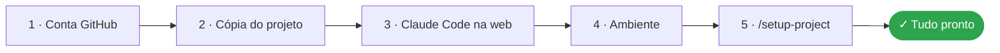
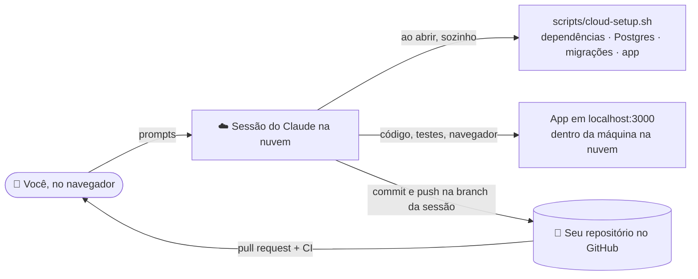

# Na nuvem — sem instalar nada

Como usar o **Dev Foundation** e fazer o workshop inteiro no navegador, com o **Claude Code na web** ([claude.ai/code](https://claude.ai/code)). Não precisa de Git, Docker nem Node no computador: o Claude trabalha numa máquina na nuvem que já vem com Node, Postgres e um navegador para os testes.




## Como funciona



- Ao abrir cada sessão, o hook `.claude/hooks/session-start.sh` roda o [`scripts/cloud-setup.sh`](scripts/cloud-setup.sh): instala as dependências, liga o Postgres, aplica as migrações e sobe o app. Na primeira vez leva cerca de 1 minuto; depois, segundos.
- Os comandos são os mesmos do projeto, **sem** o `docker compose exec -T app` na frente (`npm test`, `npm run db:query -- "…"`). O Claude já sabe disso pelo `CLAUDE.md`.
- O teste no navegador (`/test-in-browser`) usa o Playwright que já vem na máquina: o Claude navega pelo app e mostra as capturas de tela.
- O seu trabalho fica salvo no GitHub: cada sessão trabalha numa branch própria e termina num pull request.

> [!IMPORTANT]
> A máquina da sessão é temporária. O que não estiver no GitHub (commit e push) se perde quando a sessão termina, inclusive os dados do banco. No workshop isso não é problema: o catálogo é recarregado da planilha em segundos.

---

## 1 · 🐙 Conta no GitHub

Crie uma conta gratuita em [github.com](https://github.com/signup), se ainda não tiver.

## 2 · 📦 A sua cópia do projeto

Abra [github.com/Blueydata/ai-dev-foundation](https://github.com/Blueydata/ai-dev-foundation) e clique em **Fork**. Dê um nome, por exemplo `torra-sul`, e crie.

## 3 · 🤖 Claude Code na web

| Passo | O que fazer |
| :---: | --- |
| 1 | Entre em [claude.ai/code](https://claude.ai/code) com a conta do plano **Pro ou superior** |
| 2 | Conecte o GitHub quando ele pedir e autorize o acesso ao repositório que você criou |
| 3 | Escolha o repositório no seletor de repositórios |

## 4 · ⚙️ O ambiente

No seletor de ambiente da sessão, crie um ambiente (ou edite o **Default**) com:

| Item | Valor | Para quê |
| --- | --- | --- |
| **Acesso à rede** | O nível padrão (**Trusted**/limitado) já basta, com os gerenciadores de pacotes liberados | Instalar as dependências do projeto |
| **Variáveis de ambiente** | `ADMIN_EMAIL=...` e `ADMIN_PASSWORD=...`, com um login **inventado só para o workshop** | O login do administrador (etapa 5 do workshop) |
| **Opcional: chave da OpenAI** | Veja abaixo | O chat com IA responder |

> [!CAUTION]
> As variáveis de ambiente ficam guardadas em texto no ambiente e a máquina da sessão consegue lê-las. Use um e-mail e uma senha inventados para o workshop, **nunca** a senha de uma conta sua. E nunca cole esses valores na conversa.

<details>
<summary><strong>🔑 Opcional: chave da OpenAI, para o chat com IA responder</strong></summary>

<br>

| Passo | O que fazer |
| :---: | --- |
| 1 | Crie uma conta em [platform.openai.com](https://platform.openai.com), adicione um pouco de crédito (US$ 5 sobram) e gere uma chave em **API keys** |
| 2 | Nas configurações do ambiente, em **Network secrets** (ou **API credentials**), salve a chave para o host `api.openai.com`, no cabeçalho `Authorization`, com o prefixo `Bearer`. Isso também libera o acesso ao `api.openai.com` |
| 3 | Nas variáveis de ambiente, acrescente `OPENAI_API_KEY=via-network-secret`: o app precisa de um valor, e a chave de verdade é colocada no caminho pela rede da nuvem, sem nunca entrar na máquina |

Se preferir, quando o Claude precisar da chave ele mesmo abre um cartão seguro para você salvar: digite a chave ali, nunca na conversa.

Sem a chave, todo o resto funciona; só o chat avisa que a IA está indisponível.

</details>

Depois de mudar o ambiente, **comece uma sessão nova**: as variáveis só entram em sessões abertas depois da mudança.

## 5 · ✅ Teste final

Na sessão nova, digite:

```
/setup-project
```

**Está pronto quando aparecer assim:**

```
✓ Ambiente na nuvem (nada instalado no computador)
✓ Aplicação e banco no ar (http://localhost:3000)
✓ Testes e tipos
✓ Sem segredos no código
– Chave da OpenAI não configurada (opcional: só o chat precisa dela)
✗ "Product" ainda não preenchido no CLAUDE.md → é o próximo passo
```

---

## 🗺️ O workshop na nuvem

Os prompts são **os mesmos** do [`WORKSHOP.md`](WORKSHOP.md). O que muda:

| Etapa | No computador | Na nuvem |
| --- | --- | --- |
| 1 · Projeto | `/setup-project` confere Git e Docker | `/setup-project` confere só o app, o banco e os testes |
| 5 · Login do administrador | Você escreve `ADMIN_EMAIL` e `ADMIN_PASSWORD` no `.env` | Você já colocou nas **variáveis de ambiente** (passo 4). No Prompt 6, troque "no arquivo .env" por "nas variáveis de ambiente da nuvem" |
| 🌐 Navegador | Painel **Browser** ou http://localhost:3000 | O Claude testa com o navegador da máquina na nuvem e mostra as telas. Para ver você mesmo, peça: `Me mostre uma captura de tela de /admin` |
| 7 · Tokens | `/context`, `/usage`, `/compact` | Os mesmos comandos, se aparecerem na sua sessão; senão, pule |
| 12 · Infraestrutura | `docker compose run --rm infra check` | Não roda na nuvem (precisa de Docker): o CI confere no pull request |
| 14 · Entrega | `/deliver` prepara o pull request | `/deliver` faz o push da branch da sessão e abre o pull request no **seu** repositório; o CI roda ali |

> [!TIP]
> Uma conversa por funcionalidade. Se a sessão cair, abra outra no mesmo repositório e branch: o hook sobe tudo de novo e o código está no GitHub.
