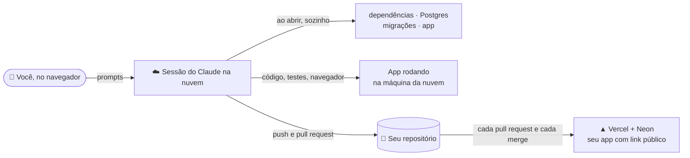

# Pré-requisitos — tudo na nuvem, sem instalar nada

O que você precisa para usar o **Dev Foundation** e fazer o workshop "Desenvolvimento de software com IA" inteiro no navegador, com o **Claude Code na web** ([claude.ai/code](https://claude.ai/code)). Não precisa de Git, Docker nem Node no computador: o Claude trabalha numa máquina na nuvem que já vem com Node, Postgres e um navegador para os testes. Prefere rodar no seu computador? Veja o [`LOCAL.md`](LOCAL.md).

## O que você vai usar

São **três contas pessoais** e **uma chave**:

| | Conta | Para quê | Plano |
| :---: | --- | --- | --- |
| 🐙 | **GitHub**, pessoal | Guardar o código e cada versão | Gratuito |
| ▲ | **Vercel**, pessoal, criada com o login do GitHub | Colocar o app no ar; o banco de dados (Neon) é criado dentro dela, sem outra conta | Hobby, gratuito, sem cartão |
| 🤖 | **Claude**, pessoal | A IA que constrói o software, numa máquina na nuvem | **Pro ou Max** (um plano Team ou Enterprise da empresa também serve, se o Claude Code na web estiver liberado) |
| 🔑 | **Chave da OpenAI** | A IA do chat do app que você vai construir | A organização fornece uma no dia; **recomendado levar a sua** (US$ 5 de crédito sobram) |

> [!IMPORTANT]
> Use a **conta pessoal** do GitHub, não a da empresa: repositórios de organizações precisam de aprovação de um administrador para o Claude e de plano pago na Vercel.

## Como funciona

- Ao abrir cada sessão, o projeto se prepara sozinho (o hook `.claude/hooks/session-start.sh` roda o [`scripts/cloud-setup.sh`](scripts/cloud-setup.sh)). Na primeira vez leva cerca de 1 minuto; depois, segundos.
- O Claude testa o app com um navegador da própria máquina na nuvem e mostra capturas de tela.
- O seu trabalho fica salvo no GitHub: cada sessão trabalha numa branch própria e termina num pull request. A Vercel publica cada pull request num link de prévia e, depois do merge, no link oficial.

> [!IMPORTANT]
> A máquina da sessão é temporária: o que não estiver no GitHub se perde quando a sessão termina. O Claude faz o commit e o push por você.

---

## 1 · 🐙 GitHub pessoal

Crie uma conta gratuita em [github.com/signup](https://github.com/signup), se ainda não tiver uma pessoal.

## 2 · 🤖 Claude conectado ao GitHub

| Passo | O que fazer |
| :---: | --- |
| 1 | Entre em [claude.ai/code](https://claude.ai/code) com a sua conta do plano **Pro ou Max** |
| 2 | Conecte o GitHub quando ele pedir, com a sua **conta pessoal**, e autorize o acesso aos seus repositórios (pode ser a todos ou só aos que você escolher) |

## 3 · 🔑 Chave da OpenAI

> [!TIP]
> A organização fornece uma chave para o dia do workshop, que é **desativada depois**. Com a sua própria chave, o app que você publicar continua respondendo no chat depois do workshop.

| Passo | O que fazer |
| :---: | --- |
| 1 | **Recomendado:** crie uma conta em [platform.openai.com](https://platform.openai.com), adicione um pouco de crédito (US$ 5 sobram) e gere uma chave em **API keys**. Sem chave própria, use a que a organização vai fornecer no dia do workshop. Guarde a chave num lugar seguro: você vai usá-la de novo na Vercel |
| 2 | No Claude Code na web, abra o menu do ambiente da sessão e clique em **Edit**. Em **Network secrets** (ou **API credentials**), salve a chave para o host `api.openai.com`, no cabeçalho `Authorization`, com o prefixo `Bearer`. Isso também libera o acesso da sessão ao `api.openai.com` |
| 3 | Nas **variáveis de ambiente** do mesmo ambiente, acrescente `OPENAI_API_KEY=via-network-secret`. O app precisa de um valor ali, e a chave de verdade é colocada no caminho pela rede da nuvem, sem nunca entrar na máquina |

Depois de mudar o ambiente, **comece uma sessão nova**: as mudanças só valem para sessões abertas depois delas.

> [!CAUTION]
> **Nunca cole a chave na conversa** com o Claude, nem em arquivos do projeto. Se o Claude precisar dela, ele mesmo abre um cartão seguro para você salvar.

Sem a chave, todo o resto funciona; só o chat avisa que a IA está indisponível.

## 4 · ▲ Vercel pessoal

Entre em [vercel.com/signup](https://vercel.com/signup) com **Continue with GitHub**, usando a mesma conta pessoal do GitHub, no plano **Hobby** (gratuito, sem cartão). Por enquanto é só isso: o projeto é conectado durante o workshop.

## 5 · ✅ Teste final

Abra [claude.ai/code](https://claude.ai/code) e comece uma sessão nova: no seletor de repositórios aparecem os repositórios da sua conta pessoal do GitHub. Pronto: o resto, inclusive criar o repositório do projeto, a gente faz junto no workshop.

> [!TIP]
> Os prompts, na ordem, estão no [`WORKSHOP.md`](WORKSHOP.md): não precisa fazer nada com ele antes.

> [!TIP]
> **Travou?** Peça ajuda ao próprio Claude colando a mensagem de erro que apareceu.
