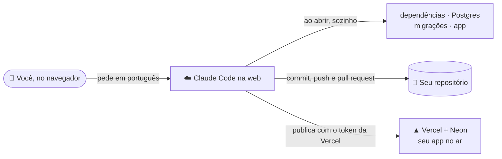

# Pré-requisitos — tudo na nuvem, sem instalar nada

O que deixar pronto antes do workshop "Desenvolvimento de software com IA": três contas pessoais e duas chaves. Tudo acontece no navegador, no **Claude Code na web** ([claude.ai/code](https://claude.ai/code)); não precisa instalar nada. Prefere rodar no seu computador? Veja o [`LOCAL.md`](LOCAL.md).


## Por que contas pessoais

| | Caminho | Resultado |
| :---: | --- | --- |
| ✅ | GitHub **pessoal** → Vercel **Hobby** | App no ar, de graça |
| 💲 | GitHub da **empresa** (organização) → Vercel **Pro** | Plano pago, e ainda pede aprovação de um administrador |

O plano gratuito da Vercel só publica repositórios de contas pessoais do GitHub.

## Como funciona



- Cada sessão prepara o projeto sozinha ([`scripts/cloud-setup.sh`](scripts/cloud-setup.sh)): na primeira vez leva cerca de 1 minuto; depois, segundos.
- O Claude testa o app num navegador da própria nuvem, faz o commit e o push, abre o pull request e **publica na Vercel** por você.
- As chaves ficam num cofre do ambiente do Claude: ele as usa sem nunca vê-las.

---

## 1 · 🐙 GitHub

Crie a sua conta **pessoal** em [github.com/signup](https://github.com/signup) e confirme o e-mail. Já tem uma pessoal? Pule.

## 2 · 🤖 Claude Code na web

O workshop inteiro acontece no Claude Code na web. O seu plano precisa incluir esse acesso:

| Plano | Acesso ao Claude Code na web |
| --- | --- |
| **Pro**, **Max**, **Ultra** | ✅ |
| **Team**, **Enterprise** | Só se o administrador da empresa liberou |
| **Free** | ❌ |

1. Entre em [claude.ai/code](https://claude.ai/code). Se aparecer um pedido de upgrade, o seu plano não inclui.
2. Conecte o GitHub com a sua **conta pessoal** e libere **All repositories**.

## 3 · ▲ Vercel

Em [vercel.com/signup](https://vercel.com/signup), escolha **Hobby** e entre com **Continue with GitHub**, usando o GitHub pessoal. É grátis e sem cartão.

## 4 · 🔑 Token da Vercel

É com ele que o Claude publica o app por você.

1. Abra [Account Settings → Tokens](https://vercel.com/account/settings/tokens).
2. Crie um token com o nome `workshop` e validade de 30 dias.
3. **Copie**: ele aparece uma vez só. Guarde até o passo 6.

## 5 · 🔑 Chave da API da Anthropic

É o Claude respondendo no chat do app que você vai construir.

1. Entre em [platform.claude.com](https://platform.claude.com) e compre um pouco de crédito em [Billing](https://platform.claude.com/settings/billing).
2. Em [API keys](https://platform.claude.com/settings/keys), clique em **Create key**.
3. **Copie** (começa com `sk-ant-` e aparece uma vez só). Guarde até o passo 6.

> [!TIP]
> No dia, a Bluey empresta uma chave, desativada depois do workshop. Com a sua, o app continua respondendo depois.

## 6 · 🔐 Cofre do Claude

Em [claude.ai/code](https://claude.ai/code): menu do ambiente **Default** → **Edit** → **Network secrets** (em algumas versões, **API credentials**). Crie dois segredos:

| Segredo | Host | Cabeçalho | Prefixo |
| --- | --- | --- | --- |
| Token da Vercel (passo 4) | `api.vercel.com` | `Authorization` | `Bearer` |
| Chave da Anthropic (passo 5) | `api.anthropic.com` | `x-api-key` | nenhum |

No mesmo ambiente, em **variáveis de ambiente**, acrescente:

```
ANTHROPIC_API_KEY=via-network-secret
```

O app precisa de um valor ali; a chave de verdade é colocada no caminho pela rede da nuvem, sem nunca ficar visível.

> [!CAUTION]
> **Nunca cole chaves, tokens ou senhas na conversa** com o Claude, nem em arquivos do projeto. Elas ficam só no cofre e, no dia, na Vercel.

## 7 · ✅ Teste

Em [claude.ai/code](https://claude.ai/code), comece uma sessão nova: o Claude Code abre sem pedir upgrade e os repositórios do seu GitHub aparecem na lista? Pronto.

---

Os prompts do workshop, na ordem, estão no [`WORKSHOP.md`](WORKSHOP.md): não precisa fazer nada com ele antes.
