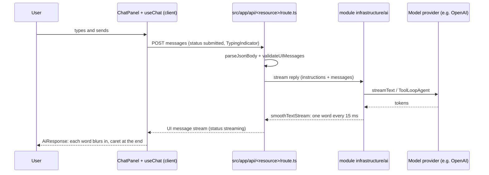

# AI

How language models and agents are integrated. Dev Foundation ships the shared streaming and chat UI pieces; features add their models, instructions and agents in their module `infrastructure/ai/` folder, and list them in the table below.

## Integrations

| Module | Model setting | Instructions | Tools | Route | Limits |
| --- | --- | --- | --- | --- | --- |
| none yet | | | | | |

## Streaming pipeline

Every answer shown to a user is streamed and animated, so it never looks stuck. The sequence shows a chat message from the composer to the screen.

| Piece | What it does | Where |
| --- | --- | --- |
| `smoothTextStream()` | Wraps `smoothStream` with word chunks every 15 ms, so text flows at a steady pace | `src/shared/ai/stream.ts` |
| `ChatPanel` | Welcome, suggestions, messages, typing indicator, errors with retry, composer with send and stop, auto scroll | `src/shared/ui/ai/chat-panel.tsx` |
| `AiResponse` | Renders Markdown with Streamdown, animating each new word (blur-in, 280 ms) with a caret while streaming | `src/shared/ui/ai/ai-response.tsx` |
| `toChatPanelMessages` | Maps AI SDK `UIMessage` parts to the panel messages | `src/shared/ui/ai/to-chat-panel-messages.ts` |

## Rules

- Server only: the provider key and model name come from `getServerEnv()`; the key is a user-provided, optional variable, and without it the feature answers with `UnavailableError` while the rest of the app works.
- Instructions are separate from user text, in English, and tell the assistant to answer in the product language.
- Agent tools call use cases received as dependencies, never SQL directly.
- Limits on message count and size, agent steps (`stopWhen`) and requests on public routes.
- Tests mock the model with `MockLanguageModelV4`; no test calls a real provider.

Related: [security](security.md) · [ui](ui.md)
