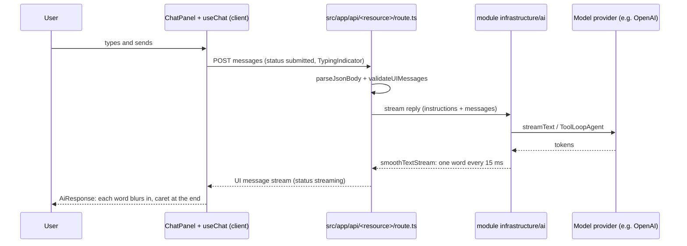
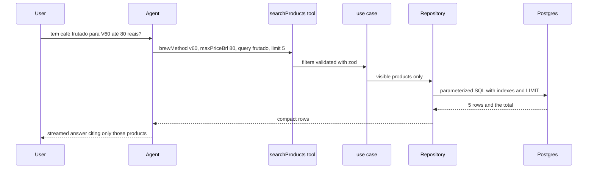

# AI

How language models and agents are integrated. Dev Foundation ships the shared streaming and chat UI pieces; features add their models, instructions and agents in their module `infrastructure/ai/` folder, and list them in the table below.

## Integrations

| Module | Model setting | Instructions | Tools | Route | Limits |
| --- | --- | --- | --- | --- | --- |
| none yet | | | | | |

## Streaming pipeline

Every answer shown to a user is streamed and animated, so it never looks stuck. The sequence shows a chat message from the composer to the screen.

| Piece | What it does | Where |
| --- | --- | --- |
| `smoothTextStream()` | Wraps `smoothStream` with word chunks every 15 ms, so text flows at a steady pace | `src/shared/ai/stream.ts` |
| `ChatPanel` | Welcome, suggestions, messages, typing indicator, errors with retry, composer with send and stop, auto scroll | `src/shared/ui/ai/chat-panel.tsx` |
| `AiResponse` | Renders Markdown with Streamdown, animating each new word (blur-in, 280 ms) with a caret while streaming | `src/shared/ui/ai/ai-response.tsx` |
| `toChatPanelMessages` | Maps AI SDK `UIMessage` parts to the panel messages | `src/shared/ui/ai/to-chat-panel-messages.ts` |

## Rules

- Server only: the provider key and model name come from `getServerEnv()`; the key is a user-provided, optional variable, and without it the feature answers with `UnavailableError` while the rest of the app works.
- Instructions are separate from user text, in English, and tell the assistant to answer in the product language.
- Agent tools call use cases received as dependencies, never SQL directly.
- Data reaches the model only through tools with typed filters and at most 10 compact rows per call; the whole table is never put in the prompt. Visibility and permission rules live in the use case or the query, never only in the instructions.
- Limits on message count and size, agent steps (`stopWhen`) and requests on public routes.
- Tests mock the model with `MockLanguageModelV4`; no test calls a real provider.

## Answering questions over data

Users ask in plain language; the model chooses a tool and fills typed filters; the database filters, ranks and counts; the model writes the answer from a few rows.

The tool set per data source is search with filters, details of one item, summaries computed in SQL (counts, minimum, maximum, groups) and the list of categories. See the `ai-integration` skill, section "Answering questions over data", and `database-queries` for the queries behind them.

## Cost

| Lever | Effect |
| --- | --- |
| Small model by default, larger only with evidence | Lower price per token |
| Short, stable instructions | Provider prompt caching of the prefix |
| Data through tools, a few rows per call | Input tokens stay flat as the catalog grows |
| Limits on messages, output tokens, steps and requests | Bounded cost per conversation and protection against abuse |
| Recent history only in long conversations | Input tokens stop growing with the conversation |
| `usage` totals recorded without content | Cost visible per feature, without personal data |

Related: [security](security.md) · [ui](ui.md)
