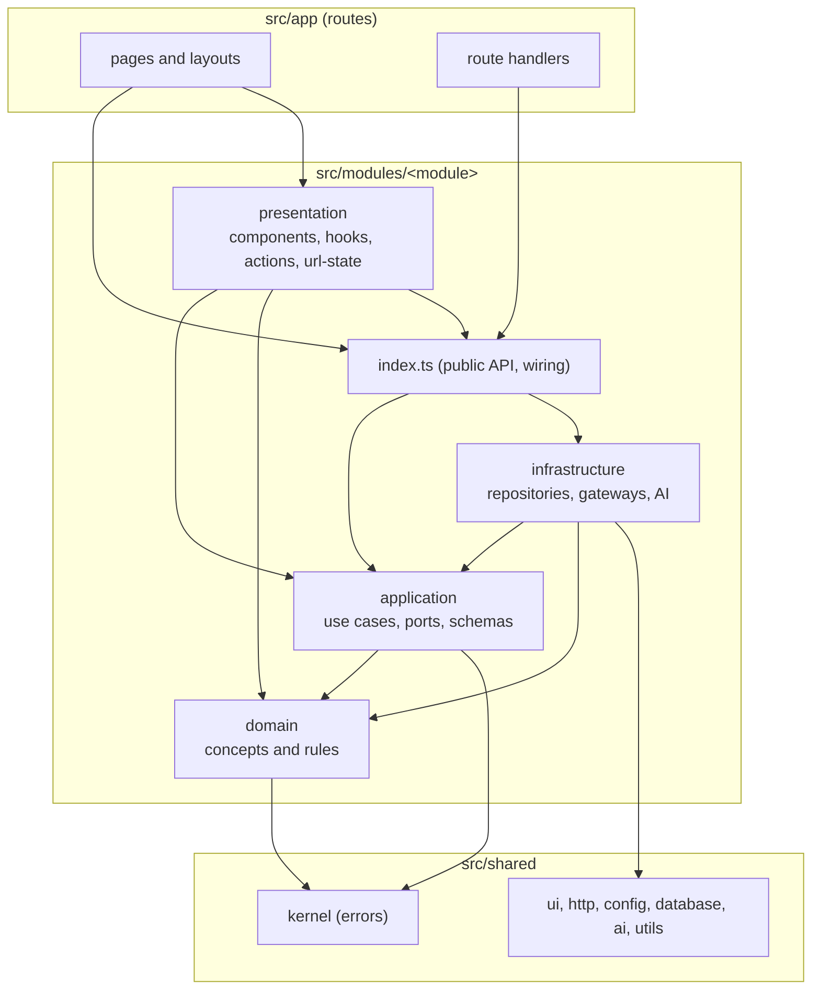
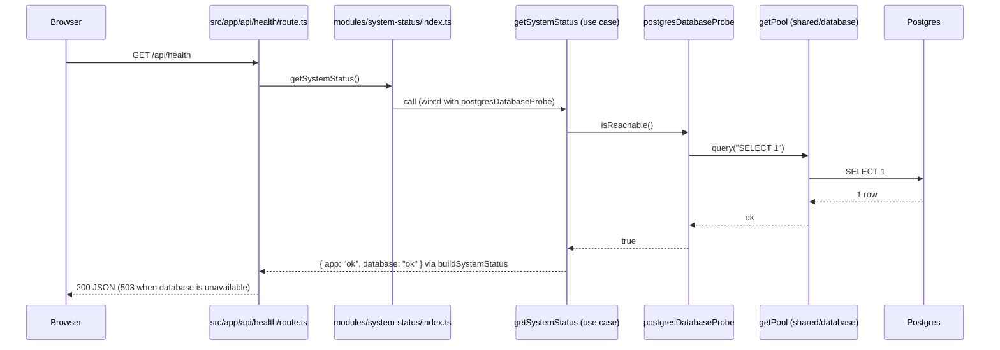
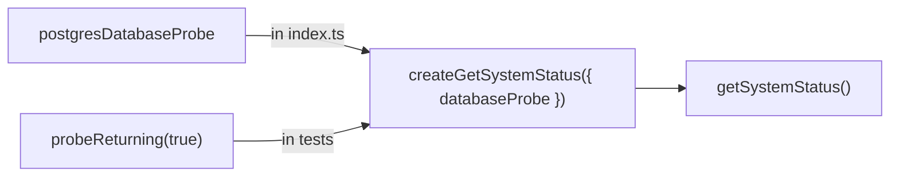
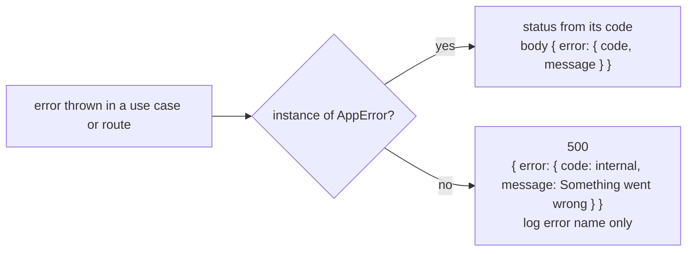

# Architecture

How the code is organized and how a request moves through it. All source code lives in `src/`: routes in `src/app/`, business capabilities in `src/modules/`, shared building blocks in `src/shared/`. The rules below are enforced by `src/architecture.test.ts` on every test run and in CI. See [decision 0002](decisions/0002-modular-architecture.md) for why.

## Layers

Each module has the same four layers plus a public `index.ts`. The diagram shows what may import what; arrows point in the allowed direction.

| Layer | Responsibility | May import |
| --- | --- | --- |
| `domain` | Business concepts and rules, pure TypeScript | Its own domain, `shared/kernel` |
| `application` | Use cases, the ports they need, input schemas, module errors | Its own domain and application, `shared/kernel`, `zod` |
| `infrastructure` | Implementations of the ports: SQL repositories, external API gateways, AI | Its own domain, application and infrastructure, `shared/*`, packages, another module's `index.ts` |
| `presentation` | Components, client hooks, server actions, URL state | Its own domain, application, presentation and `index.ts`, `shared/*` except database, config and ai |
| `index.ts` | Wires use cases with infrastructure and exports them | Its own layers except presentation, `shared/*` |
| `src/app` | Routes: parse input, call a module, render or return | Module `index.ts` and `presentation`, `shared/*` |
| `src/shared` | Infrastructure and UI with no business rules | `shared/*` and packages only |

## Rules enforced by the architecture test

| Rule | Why |
| --- | --- |
| Dependencies follow the table above | Business rules never depend on frameworks, databases or screens |
| Modules talk to each other only through `index.ts`, from `infrastructure` or `index.ts` | A module can change inside without breaking others |
| Modules contain only `domain`, `application`, `infrastructure`, `presentation` and `index.ts`; `application` only `use-cases/`, `ports.ts`, `schemas.ts`, `errors.ts`; `presentation` only `components/`, `hooks/`, `actions/`, `url-state.ts` | Every file has one predictable place |
| Client components never import a module `index.ts`, `infrastructure`, `shared/database`, `shared/config` or `shared/ai` | Server code and secrets never reach the browser |
| Server actions only in `presentation/actions/` | Mutations from forms are easy to find and review |
| Only `infrastructure` imports `shared/database` | All SQL lives in repositories |
| Only `shared/config/env.ts` reads `process.env` | Configuration is validated in one place |
| Integration tests only next to `infrastructure` or `shared/database` | They test real adapters, not rules |
| Files and folders in kebab-case; migrations `NNNN-description.sql` | Consistent names, ordered migrations |
| No comments in code, CSS, SQL, YAML or `.env.example` | Explanations live in this documentation |

## Request lifecycle

The sequence shows a typical API request, using the real `GET /api/health` route; pages follow the same path, rendering a component instead of returning JSON.

## Dependency injection

Use cases are factories that receive their dependencies and return the use case function. `index.ts` passes the real implementations; tests pass fakes, so project code needs no module mocking.

## Error handling

Code throws typed errors from `src/shared/kernel/errors.ts`. Route handlers wrapped in `withErrorHandling` turn them into the right HTTP status with a safe message; anything else becomes a generic 500 and only the error name is logged.

| Error | Code | HTTP status |
| --- | --- | --- |
| `ValidationError` | `validation` | 400 |
| `UnauthorizedError` | `unauthorized` | 401 |
| `ForbiddenError` | `forbidden` | 403 |
| `NotFoundError` | `not_found` | 404 |
| `ConflictError` | `conflict` | 409 |
| `UnavailableError` | `unavailable` | 503 |
| Any other error | `internal` | 500 |

`parseJsonBody(request, schema)` throws `ValidationError` for invalid JSON or a body that does not match the zod schema, with the issues in `details` (not sent to the client).

## Module map

| Module | Capability | Page |
| --- | --- | --- |
| `system-status` | Reports whether the app and the database are running | [modules/system-status.md](modules/system-status.md) |

## Notes

- **Wiring is lazy where it reads configuration.** Anything that calls `getServerEnv()` (database pool, AI model) runs on the first request, not at import time, so `next build` and unit tests do not need real values.
- **Server components are the default.** `"use client"` is added only to the smallest component that needs state, effects or browser APIs; client components reach the server through server actions, route handlers or props.
- **`AGENTS.md` is written by `next dev`.** It points coding agents to the docs bundled with the installed Next.js version, which can differ from what models know. It is committed so the tree stays clean.

Related: [project structure](project-structure.md) · [system-status module](modules/system-status.md) · [testing and quality](testing-and-quality.md)
