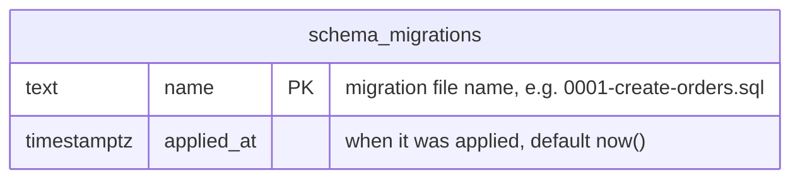
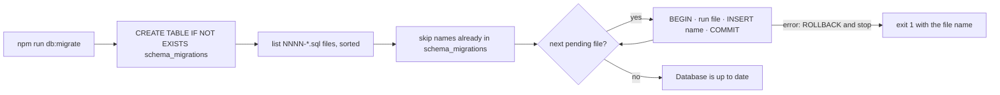

# Data model

Every table in the database, how tables relate and how the schema changes. The database is Postgres 17, reached only through repositories in module `infrastructure/` folders, with parameterized SQL.

## Tables

Dev Foundation starts with one table, created by the migration runner itself to record which migrations ran. Feature tables are added here, with their module, as migrations create them.

| Table | Module | Purpose | Created by |
| --- | --- | --- | --- |
| `schema_migrations` | none (tooling) | Names of the migrations already applied | `scripts/migrate.mjs` |

## Migrations

Schema changes are SQL files in `src/shared/database/migrations/`, named `NNNN-description.sql` (four digits, kebab-case). The runner applies the pending ones in order, each in its own transaction together with its record in `schema_migrations`.

| Migration | Module | What it does |
| --- | --- | --- |
| none yet | | |

## Conventions

- Tables and columns in English `snake_case`, tables in plural (`orders`, `product_folders`).
- Primary keys `id` as `uuid` with `gen_random_uuid()` or `bigint generated always as identity`; foreign keys `<table_singular>_id`.
- `created_at` and `updated_at` as `timestamptz not null default now()` on business tables.
- Constraints in the database for what must always be true (`not null`, `unique`, `check`, foreign keys), validation with zod at the boundaries.
- Never edit an applied migration: changes come as a new file.
- Personal data only when the feature needs it (LGPD), documented here with its purpose.

Related: [architecture](architecture.md) · [runtime and configuration](runtime-and-configuration.md)
