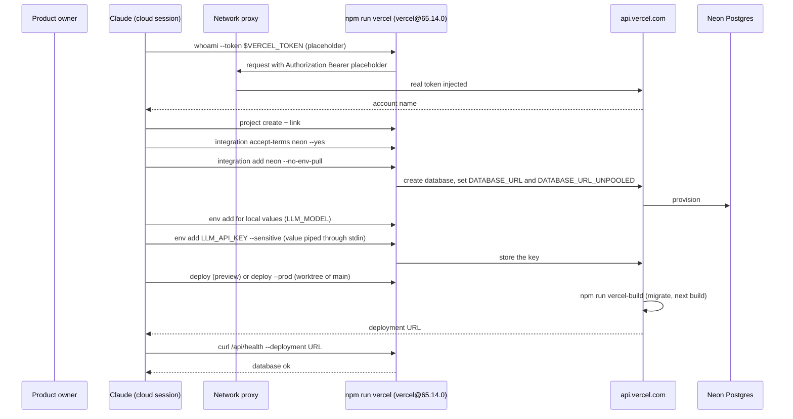
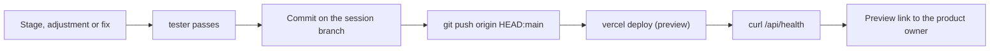

# Deployment

How the app is published: every finished stage is merged into `main` and shown in a preview, and `/deliver` publishes production. Claude publishes it on Vercel with the pinned Vercel CLI, Neon provides the Postgres database, both on free plans, with no infrastructure code in the repository. The decisions are [0004](decisions/0004-vercel-and-neon-instead-of-aws.md) (Vercel and Neon) and [0007](decisions/0007-claude-publishes-through-the-vercel-cli.md) (the CLI) and [0008](decisions/0008-merge-and-preview-every-step.md) (a merge and a preview for every step). The `deploy` skill (`.claude/skills/deploy/SKILL.md`) is the step-by-step flow Claude follows.

## How a publish works

The diagram shows the first publish and a regular one, from the session to the live URL. The product owner appears only where a person must act.

On a failed build Claude runs `inspect <url> --logs`, fixes the cause in the code, pushes and deploys again; after 3 failed attempts it stops and explains.

## The Vercel CLI and the token

| Item | Detail |
| --- | --- |
| Command | `npm run vercel -- <command> --token "$VERCEL_TOKEN"`; the script is `npx --yes vercel@65.14.0`, so the version is pinned |
| Token | A network secret of the cloud environment for `api.vercel.com`, header `Authorization`, prefix `Bearer`, set by the product owner in the environment settings (`PREREQUISITES.md`) |
| In the session | `scripts/cloud-setup.sh` exports `VERCEL_TOKEN=vianetworksecret` (placeholder) and `VERCEL_TELEMETRY_DISABLED=1`; the proxy replaces the placeholder with the real token, which Claude never sees |
| Project name | The repository folder name in lowercase |
| Link | `vercel link` writes `.vercel/`, which is git-ignored |
| Upload filter | `.vercelignore` excludes `.git`, `node_modules`, `.next`, `.vercel`, `.env` and `.env.*` (except `.env.example`) and `*.log` |

## Environments

| Environment | Created by | Purpose |
| --- | --- | --- |
| Preview | `deploy` after every finished stage, adjustment or fix, once it is merged into `main` ("Merge and show a step" in the `deploy` skill) | A link for the product owner to look at what the step built |
| Production | `deploy --prod` from a worktree of `origin/main` (`git worktree add /tmp/release origin/main`, `--cwd /tmp/release`), at `/deliver` | The live app, open to anyone |

Preview links ask for a Vercel sign-in; that is expected.

## Variables

| Variable | Set by | Used by | Purpose |
| --- | --- | --- | --- |
| `DATABASE_URL` | Neon integration, for every environment | `src/shared/config/env.ts` (the app) | Pooled connection used while the app runs |
| `DATABASE_URL_UNPOOLED` | Neon integration, for every environment | `scripts/migrate.mjs` | Direct connection used to apply migrations; `selectMigrationUrl` prefers it over `DATABASE_URL` |
| Local values with a default in `docker-compose.yml` (for example `LLM_MODEL`) | Claude, with `vercel env add <NAME> <environment>` for `production` and `preview` | `getServerEnv()` | Not secrets; same values as in development |
| Names listed in `.env.example` (for example `LLM_API_KEY`) | Claude, copied from the session with `printf '%s' "$NAME" \| npm run --silent vercel -- env add NAME --environment production,preview --sensitive --yes --force --token "$VERCEL_TOKEN"`, so the value never appears in a command, log or the conversation | `getServerEnv()` | Keys and logins that only a person can provide. If a name is not set in the session, Claude asks the product owner to add it in the cloud environment settings and publishes without it meanwhile; `vercel env list` shows which are missing |

The integration is added with `--no-env-pull`: the Neon connection strings are never copied to the session, whose app uses its own Postgres. Values never go into the repository. A feature that adds a variable lists its name in the final report.

## Migrations on build

`npm run vercel-build` is `node scripts/migrate.mjs && next build`. Pending files in `src/shared/database/migrations/` are applied first through `DATABASE_URL_UNPOOLED`, each in its own transaction; if one fails, the build fails and the previous deployment keeps serving. A preview migrates the database it is connected to, so previews and production share the schema unless a Neon branch is used.

## Preparing the project and every publish

`/setup-project` runs steps 1 to 4 and a first preview, so the project, the database and the build are proven before the first feature. Every step is safe to repeat; a new session only runs `link`, since `.vercel/` is not committed.

1. `whoami` confirms the token; if it fails, the product owner saves the token as a network secret and opens a new session.
2. `project create <name>` and `link --yes --project <name>`.
3. `integration accept-terms neon --yes`, then `integration add neon --no-env-pull`; if it still answers with a terms link, the product owner accepts it and Claude runs it again.
4. `env add ... --value ... --no-sensitive` for local values; each key named in `.env.example` is copied from the session through stdin.
5. `deploy --yes` (preview) or `deploy --yes --prod` (production), then `curl /api/health --deployment <url>` answers `"database":"ok"`.

## Merge and show a step

1. `git fetch origin main`; if `main` moved, `git merge --no-edit origin/main` (never a rebase) and the tests run again.
2. `git push origin HEAD:main` and `git push origin HEAD`.
3. `deploy --yes`; a failed build is read with `inspect --logs` and fixed, at most 3 attempts.
4. `curl /api/health --deployment <url>`, then the product owner gets the link with one line on what to look at. Claude goes on without waiting.

## Marketplace integrations

When a feature needs a capability the project does not have (login, e-mail, file storage, payments, cache, search…), Claude looks for a Vercel Marketplace integration before writing it or bringing another service:

1. `integration discover --json` and `integration guide <name>` to compare the options.
2. A proposal of at most 3 lines: the integration, its free plan and cost, what it provides. Nothing is installed without the product owner's approval.
3. Once approved: `integration accept-terms <name> --yes` and `integration add <name> --no-env-pull`, a gateway in the module's `infrastructure/`, new variables in `src/shared/config/env.ts` and `.env.example`, and a decision record. The product owner adds the variables to the cloud environment for local development.

## Limits

- Vercel Hobby is for non-commercial use only; a commercial product needs a paid plan.
- With the Git integration, Hobby accepts only repositories of personal GitHub accounts, not organization repositories. Publishing through the CLI uploads the files directly and does not connect the repository, which avoids this restriction.
- Vercel Hobby and Neon free plans have usage limits and are meant for learning and small products.
- Functions are serverless: no long-running processes and a maximum duration per request, which matters for long AI streams.
- Pushing to GitHub no longer publishes by itself: a publish is always a `deploy` run.

Related: [runtime and configuration](runtime-and-configuration.md) · [security](security.md) · [decision 0004](decisions/0004-vercel-and-neon-instead-of-aws.md) · [decision 0007](decisions/0007-claude-publishes-through-the-vercel-cli.md)
