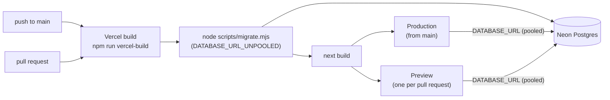

# Deployment

How the app is published: Vercel runs the app, Neon provides the Postgres database, both on free plans, with no infrastructure code in the repository. The decision and its alternatives are in [0004](decisions/0004-vercel-and-neon-instead-of-aws.md). The `deploy` skill guides the product owner through the first deploy.

## Environments

The diagram shows how a push or pull request becomes a deployment and where the build applies migrations.

| Environment | Created by | Purpose |
| --- | --- | --- |
| Production | Every push to `main` | The live app |
| Preview | Every pull request | A link to try the change before merging |

## Variables

| Variable | Set by | Used by | Purpose |
| --- | --- | --- | --- |
| `DATABASE_URL` | Neon integration, for every environment | `src/shared/config/env.ts` (the app) | Pooled connection used while the app runs |
| `DATABASE_URL_UNPOOLED` | Neon integration, for every environment | `scripts/migrate.mjs` | Direct connection used to apply migrations; `selectMigrationUrl` prefers it over `DATABASE_URL` |
| Names listed in `.env.example` (for example `ANTHROPIC_API_KEY`) | The product owner, in Vercel under Settings, Environment Variables | `getServerEnv()` | Keys and logins that only a person can provide |

Local values that have a default in `docker-compose.yml` (model names, flags) must also be added in Vercel when the app needs them online. A feature that adds a variable lists its name in the final report so it can be added in the right environments. Values never go into the repository.

## Migrations on build

`npm run vercel-build` is `node scripts/migrate.mjs && next build`. Pending files in `src/shared/database/migrations/` are applied first, each in its own transaction; if one fails, the build fails and the previous deployment keeps serving. Preview deployments migrate the database they are connected to, so use a Neon branch or accept that previews share the schema of production.

## First deploy

Summary of the steps in the `deploy` skill:

1. Import the repository at vercel.com/new with a personal GitHub account (organization repositories need a paid plan).
2. Add the names from `.env.example` under Environment Variables, with the product owner's own values.
3. Deploy. The first build fails without a database; this is expected.
4. In the project, Storage, create a Neon database (free plan, connected to all environments).
5. Redeploy, then check `GET /api/health` answers `"database":"ok"`.

## Limits

- Vercel Hobby and Neon free plans have usage limits and are meant for learning and small products.
- Functions are serverless: no long-running processes and a maximum duration per request, which matters for long AI streams.

Related: [runtime and configuration](runtime-and-configuration.md) · [security](security.md) · [decision 0004](decisions/0004-vercel-and-neon-instead-of-aws.md)
