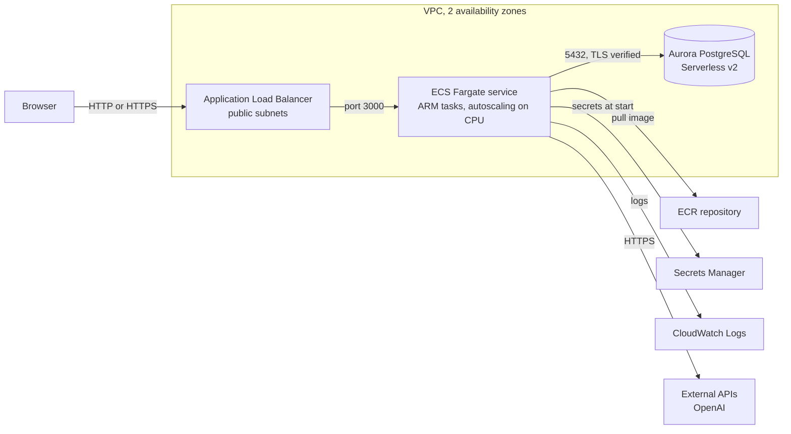
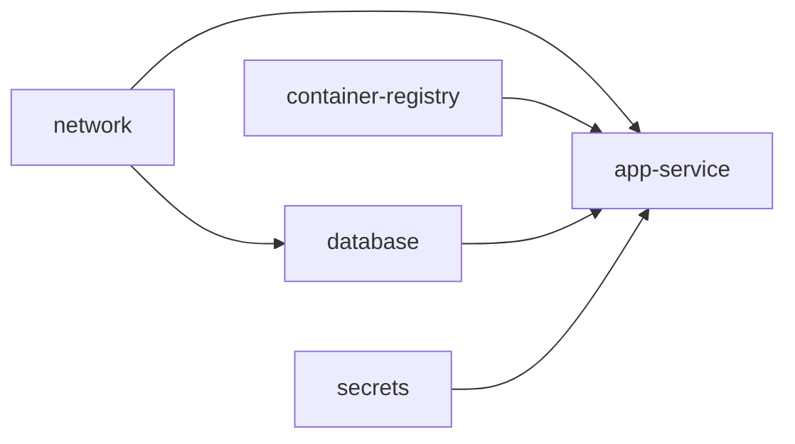

# Infrastructure

How the product runs on AWS, how the infrastructure code in `infra/` is organized, what changes between `dev` and `prod`, how to validate and deploy it, and what it costs. The rules for changing it are in the `infrastructure-as-code` skill; the `infrastructure-engineer` subagent updates it with every feature.

## Deployment



Request path: the load balancer receives the request and forwards it to a healthy task (health check `GET /api/health`). Each task runs the production image: `scripts/start.mjs` builds `DATABASE_URL` from the database endpoint and the RDS-managed credentials, applies pending migrations and starts the Next.js standalone server. The image trusts the Amazon RDS certificate bundle (`NODE_EXTRA_CA_CERTS`), so the connection uses `sslmode=verify-full`.

## Folder structure

```
infra/
├── modules/                          Terraform modules: no environment values, no providers, no backends
│   ├── network/                      VPC, subnets, internet and NAT gateways, route tables, security groups
│   ├── container-registry/           ECR repository (immutable tags, scan on push, KMS) and lifecycle policy
│   ├── secrets/                      Secrets Manager: provided secrets (empty) and generated secrets (random)
│   ├── database/                     Aurora PostgreSQL Serverless v2 cluster and instances
│   └── app-service/                  ECS cluster, task definition, service, load balancer, IAM roles, logs, autoscaling
├── live/                             Terragrunt configuration: where and with which values each module runs
│   ├── root.hcl                      S3 remote state with lockfile, generated AWS provider, default tags, common inputs
│   ├── dev/
│   │   ├── env.hcl                   Every dev value: region, sizes, flags, app configuration and secret names
│   │   └── <unit>/terragrunt.hcl     network, container-registry, secrets, database, app-service
│   └── prod/                         Same units, prod values in env.hcl
├── tools/
│   ├── Dockerfile                    Terraform, Terragrunt, TFLint with the AWS ruleset, Checkov and the AWS CLI
│   └── infra.sh                      The infra command: check, plan, apply, destroy, output, image-repo, ecr-password, aws
├── .tflint.hcl                       Lint rules
└── .checkov.yml                      Security scan settings and skipped checks
Dockerfile                            Production image of the application (repository root)
.dockerignore                         Files kept out of the image
scripts/start.mjs                     Container entry: database URL, migrations, server
```

## Units and dependencies



| Unit | Module | Reads from | Main outputs |
| --- | --- | --- | --- |
| `network` | `network` | `env.hcl` (`network`) | VPC, public and private subnets, security groups |
| `container-registry` | `container-registry` | environment name | `repository_url` |
| `secrets` | `secrets` | `env.hcl` (`provided_secrets`, `generated_secrets`) | `secret_arns`, `provided_secret_names` |
| `database` | `database` | `env.hcl` (`database`), network | `endpoint`, `port`, `database_name`, `master_user_secret_arn` |
| `app-service` | `app-service` | `env.hcl` (`app`, `app_environment`), all units above, `IMAGE_TAG` | `url`, `cluster_name`, `service_name`, `log_group_name` |

Each unit declares `mock_outputs` for its dependencies, so `plan` works before anything is created. State lives in the bucket `ai-dev-foundation-tfstate-<env>-<account id>`, created on the first run (`--backend-bootstrap`), encrypted, with S3 native locking.

## Environments

| Setting | dev | prod |
| --- | --- | --- |
| Region | `us-east-1` | `us-east-1` |
| Network | `10.10.0.0/16`, 2 zones, no NAT gateway | `10.20.0.0/16`, 2 zones, one NAT gateway per zone |
| Tasks | Public subnets with a public IP; inbound only from the load balancer | Private subnets, outbound through NAT |
| Task size | 0.5 vCPU, 1 GB, ARM64 | 1 vCPU, 2 GB, ARM64 |
| Task count | 1 to 3 | 2 to 10 |
| Database | 0 to 2 ACU (auto-pause after 600 idle seconds), 1 instance | 0.5 to 8 ACU, 2 instances in different zones |
| Database protection | No deletion protection, 1 day of backups, no final snapshot | Deletion protection, 7 days of backups, final snapshot, Performance Insights |
| Load balancer | HTTP, no deletion protection | HTTPS when `certificate_arn` is set, deletion protection |
| Logs | 7 days | 30 days, Container Insights |
| ECR | Force delete on destroy | Images kept |
| Secrets | Deleted immediately on destroy | 7-day recovery window |

The database pauses only when no connection reaches it for the whole idle period. The load balancer health check queries the database every 30 seconds, so a running service keeps it awake; it pauses when the service is scaled to zero or destroyed.

## Configuration flow

| Kind | Local (Docker Compose) | AWS |
| --- | --- | --- |
| Database connection | `DATABASE_URL` in `docker-compose.yml` | `DB_HOST`, `DB_PORT`, `DB_NAME` from the database unit, `DB_USER` and `DB_PASSWORD` from the RDS-managed secret; `scripts/start.mjs` builds `DATABASE_URL` |
| Local configuration value | `app.environment` in `docker-compose.yml` | `app_environment` in `env.hcl` |
| Key the product owner provides | `.env` | `provided_secrets` in `env.hcl`, value set with the AWS CLI |
| Generated secret | Development value in `docker-compose.yml` | `generated_secrets` in `env.hcl` |

The application always reads through `src/shared/config/env.ts`.

## Commands

Everything runs in the `infra` container (`docker compose run --rm infra <command>`); the first run builds the tools image.

| Command | What it does | Needs AWS |
| --- | --- | --- |
| `check` | `terraform fmt -check`, `terragrunt hcl fmt --check`, `terraform validate` and `tflint` on every module, Checkov scan | No |
| `plan dev` / `plan prod` | Plan for every unit of the environment (add a unit name to plan only one) | Yes |
| `apply dev [unit]` | Creates or updates the environment, or one unit | Yes |
| `destroy dev [unit]` | Deletes the environment, or one unit | Yes |
| `output dev <unit>` | Outputs of one unit | Yes |
| `image-repo dev` | Image repository URL | Yes |
| `ecr-password` | Password for `docker login` to ECR | Yes |
| `aws <arguments>` | AWS CLI, for example `aws configure sso` | Yes |

The container receives `AWS_PROFILE`, `AWS_REGION`, `AWS_ACCESS_KEY_ID`, `AWS_SECRET_ACCESS_KEY`, `AWS_SESSION_TOKEN` and `IMAGE_TAG` from the shell and mounts `~/.aws`.

## Deploy

The steps for `dev`; `prod` is the same with `prod`. Commands are for macOS and Linux shells; on Windows PowerShell, set variables with `$env:NAME="value"`.

1. **Credentials.** Use an IAM Identity Center user, never the root user. Once: `docker compose run --rm infra aws configure sso` (choose a profile name), then in each new terminal `export AWS_PROFILE=<profile>` and `docker compose run --rm infra aws sso login --use-device-code`.
2. **Registry:** `docker compose run --rm infra apply dev container-registry`.
3. **Image:**

```bash
REPOSITORY=$(docker compose run --rm -T infra image-repo dev)
docker compose run --rm -T infra ecr-password | docker login --username AWS --password-stdin "${REPOSITORY%%/*}"
TAG=$(git rev-parse --short HEAD)
docker buildx build --platform linux/arm64 -t "$REPOSITORY:$TAG" --push .
```

4. **Everything else:** `IMAGE_TAG=$TAG docker compose run --rm infra apply dev`. The database takes about 10 to 15 minutes the first time.
5. **Provided secrets:** for each name in `provided_secrets`, `docker compose run --rm infra aws secretsmanager put-secret-value --secret-id ai-dev-foundation/dev/<NAME> --secret-string '<value>'`. Then restart the tasks: `docker compose run --rm infra aws ecs update-service --cluster ai-dev-foundation-dev --service ai-dev-foundation-dev --force-new-deployment`.
6. **Open** the `url` output: `docker compose run --rm infra output dev app-service`.
7. **New versions:** repeat steps 3 and 4 with a new tag. Tags are immutable.
8. **When finished:** `docker compose run --rm infra destroy dev`.

On Windows and Intel computers the ARM image is built through emulation and is slower; set `cpu_architecture = "X86_64"` in `env.hcl` and build with `--platform linux/amd64` to avoid it.

## Scalability

- **Application:** stateless tasks behind the load balancer; target tracking keeps average CPU at 60 % between `min_count` and `max_count`; the deployment circuit breaker rolls back a failing release.
- **Database:** Aurora Serverless v2 changes capacity in fractions of an ACU without restarts; `prod` has a reader in another zone for failover and read traffic.
- **Connections:** each task has one `pg` pool; keep `max_count` × pool size below the connection limit of the maximum capacity.
- **Next steps when traffic grows:** CloudFront in front of the load balancer for static files, a queue (SQS) for heavy work, RDS Proxy for many short connections, and read queries on the reader endpoint.

## Security

| Control | Where |
| --- | --- |
| Only the load balancer is public; tasks accept only the load balancer, the database only the tasks | `modules/network/security-groups.tf` |
| Default security group with no rules | `modules/network/main.tf` |
| Database credentials generated and stored by RDS; app secrets in Secrets Manager; never in code or `env.hcl` | `modules/database`, `modules/secrets` |
| Execution role reads only the secrets of the service; task role with no permissions until a feature needs one | `modules/app-service/iam.tf` |
| Encryption: database storage, ECR with KMS, state bucket, secrets | modules, `live/root.hcl` |
| TLS to the database with certificate verification | `Dockerfile`, `scripts/start.mjs` |
| Invalid HTTP headers dropped; HTTPS with TLS 1.3 policy when a certificate is set | `modules/app-service/load-balancer.tf` |
| Non-root user in the image | `Dockerfile` |
| Static checks on every change | `infra check` and CI |

Checkov checks skipped on purpose (`infra/.checkov.yml`): HTTPS-only and TLS checks (CKV_AWS_2, CKV_AWS_103, CKV_AWS_378, CKV2_AWS_20, CKV_AWS_260) because a certificate needs a domain, supported through `certificate_arn`; KMS customer-managed keys for logs, secrets, database and Performance Insights (CKV_AWS_158, CKV_AWS_149, CKV_AWS_327, CKV_AWS_354), covered by AWS-managed encryption; cost-heavy extras not enabled by default (VPC flow logs CKV2_AWS_11, load balancer access logs CKV_AWS_91, WAF CKV2_AWS_28, AWS Backup plan CKV2_AWS_8, enhanced monitoring CKV_AWS_118, query logging CKV2_AWS_27, one-year log retention CKV_AWS_338); secret rotation (CKV2_AWS_57), since provided keys rotate at their provider; security groups attached across modules (CKV2_AWS_5); and zone pinning (CKV_AWS_394), since the zone list is sliced to `az_count`.

## Costs

Approximate on-demand prices in `us-east-1`, before taxes and free tier credits:

| Resource | dev | prod |
| --- | --- | --- |
| Load balancer | about US$ 0.55 a day | about US$ 0.55 a day plus traffic |
| Fargate ARM tasks | about US$ 0.47 a day (1 task) | about US$ 1.90 a day (2 tasks) |
| Aurora Serverless v2 | about US$ 1.45 a day while awake at 0.5 ACU, storage cents | from about US$ 2.90 a day (2 instances at 0.5 ACU) |
| NAT gateways | none | about US$ 2.15 a day (2) plus traffic |
| Public IPv4 addresses | cents a day | cents a day |
| Secrets, logs, ECR | cents a day | cents a day |
| **Total** | **about US$ 3 a day** | **from about US$ 8 a day** |

Every resource carries `Project`, `Environment` and `ManagedBy` tags, so Cost Explorer shows each environment separately. Destroy `dev` when not in use.

Related: [runtime and configuration](runtime-and-configuration.md) · [security](security.md) · [decision 0003](decisions/0003-aws-infrastructure-as-code.md)
