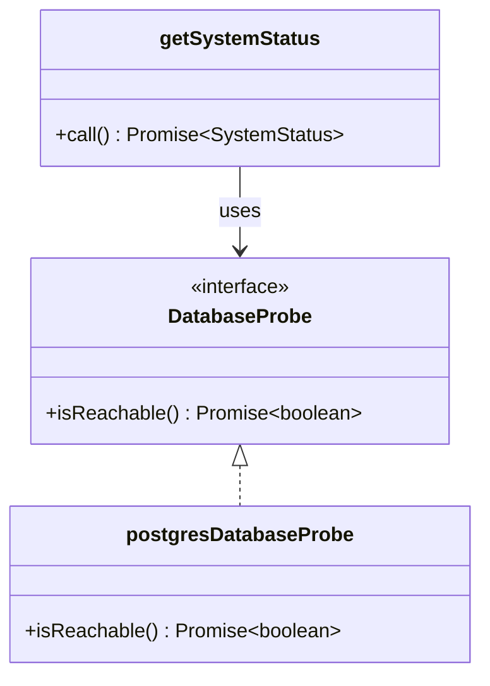
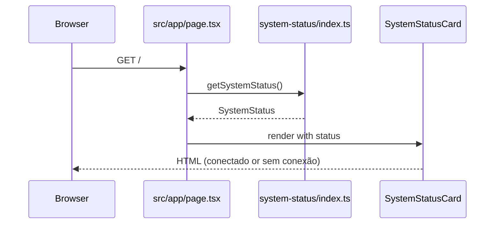

# Module: system-status

## Purpose

Reports whether the application and its database are running. It is the reference module of Dev Foundation: small, but it uses every layer, so it shows the pattern new modules follow.

## Files

```
src/modules/system-status/
├── domain/system-status.ts                                     SystemStatus, DatabaseStatus, buildSystemStatus, isSystemHealthy
├── domain/system-status.test.ts                                Unit tests of the rules
├── application/ports.ts                                        DatabaseProbe
├── application/use-cases/get-system-status.ts                  createGetSystemStatus
├── application/use-cases/get-system-status.test.ts             Unit tests with fake probes
├── infrastructure/postgres-database-probe.ts                   postgresDatabaseProbe (SELECT 1)
├── infrastructure/postgres-database-probe.integration.test.ts  Integration test against the real database
├── presentation/components/system-status-card.tsx              SystemStatusCard
└── index.ts                                                    getSystemStatus (wired), isSystemHealthy, SystemStatus
```

## Domain

| Name | Kind | Rule |
| --- | --- | --- |
| `SystemStatus` | type | `{ app: "ok"; database: "ok" \| "unavailable" }` |
| `buildSystemStatus(databaseReachable)` | function | The app is always `ok` when it answers; the database is `ok` only when reachable |
| `isSystemHealthy(status)` | function | Healthy means the database is `ok` |

## Use cases

| Use case | Input | Output | Errors | Ports |
| --- | --- | --- | --- | --- |
| `getSystemStatus` | none | `SystemStatus` | none: an unreachable database is a status, not an error | `DatabaseProbe` |

## Ports and adapters



## Flows

The home page renders the card on the server; nothing runs in the browser.



The API flow is the request lifecycle in [architecture](../architecture.md#request-lifecycle).

## Data

No tables. `postgresDatabaseProbe` only runs `SELECT 1` through the shared pool.

## Routes and screens

| Route | Kind | Uses |
| --- | --- | --- |
| `/` | Page | `getSystemStatus`, `SystemStatusCard` |
| `/api/health` | API | `getSystemStatus`, `isSystemHealthy` (see [api](../api.md)) |

## Configuration

Reads `DATABASE_URL` through the shared pool (local value set in `docker-compose.yml`).

## Tests

| File | Layer | Covers |
| --- | --- | --- |
| `domain/system-status.test.ts` | Unit | Healthy and unhealthy statuses |
| `application/use-cases/get-system-status.test.ts` | Unit | The use case with a reachable and an unreachable fake probe |
| `infrastructure/postgres-database-probe.integration.test.ts` | Integration | The probe reaches the real database |

## Notes

- The health route answers 503 when the database is down, so Docker Compose and CI (`docker compose up --wait`) wait for a working database, not just a running process.

Related: [architecture](../architecture.md) · [api](../api.md)
