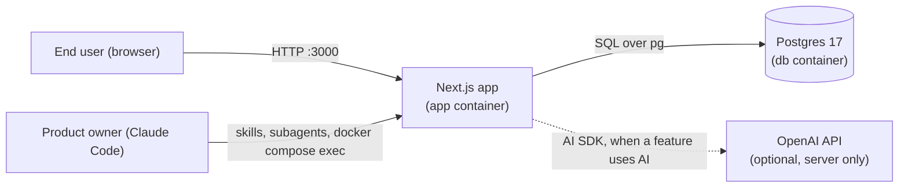

# Overview

What the system is, what it talks to and what it is built with. The project starts from **Dev Foundation**, a base to build any kind of software with AI: it ships no product, only the foundation where features are added as modules, and this page grows with them.

## Context

The diagram shows who uses the system and which services it depends on. External services appear here as soon as a feature integrates one.

## Tech stack

| Area | Technology | Version | Where |
| --- | --- | --- | --- |
| Web framework | Next.js (App Router) | 16.4.3 | `src/app/` |
| UI library | React | 19.3.1 | `src/` |
| Language | TypeScript, strict mode | 5.9.3 | `tsconfig.json` |
| Database | Postgres | 17 (alpine image) | `docker-compose.yml` |
| Database client | `pg` | 8.23.1 | `src/shared/database/client.ts` |
| Validation | zod | 4.6.7 | schemas in modules, `src/shared/config/env.ts` |
| Styling | Tailwind CSS | 4.3.3 | `src/app/globals.css` |
| Components | shadcn/ui pattern, class-variance-authority, lucide-react | 0.7.1, 1.61.0 | `src/shared/ui/` |
| Animation | Motion, tw-animate-css | 14.6.0, 1.4.0 | components |
| Typeface | Instrument Sans (Fontsource, self-hosted) | 5.3.0 | `src/app/globals.css` |
| URL state | nuqs | 2.10.2 | `src/app/layout.tsx`, module `presentation/url-state.ts` |
| AI | Vercel AI SDK (`ai`, `@ai-sdk/react`, `@ai-sdk/openai`) | 7.0.153, 4.0.157, 4.0.102 | `src/shared/ai/`, module `infrastructure/ai/` |
| Markdown streaming | Streamdown | 2.7.1 | `src/shared/ui/ai/ai-response.tsx` |
| Tests | Vitest | 5.0.5 | `vitest.config.ts`, `vitest.integration.config.ts` |
| Runtime | Node.js in Docker | 22 (alpine image) | `docker-compose.yml`, `.nvmrc` |
| CI | GitHub Actions | | `.github/workflows/ci.yml` |
| Infrastructure as code | Terraform, Terragrunt, AWS provider | 1.15.9, 1.1.6, ~> 6.50 | `infra/`, [infrastructure](infrastructure.md) |
| Cloud | AWS: ECS Fargate (ARM), Application Load Balancer, Aurora PostgreSQL Serverless v2, ECR, Secrets Manager | Aurora PostgreSQL 16.8 | `infra/modules/` |

## Quality goals

| Goal | How the project achieves it |
| --- | --- |
| Runs anywhere with no setup | Everything runs in Docker; local values live in `docker-compose.yml` ([runtime](runtime-and-configuration.md)) |
| Predictable place for every change | Modules with four layers, enforced by a test ([architecture](architecture.md)) |
| Changes do not break what works | Unit and integration tests in CI, end-to-end check by Claude in the browser ([testing](testing-and-quality.md)) |
| No leaked secrets or customer data | Secret scan in CI, server-only keys, typed errors without internals ([security](security.md)) |
| Consistent, modern UI | Theme tokens and shared components ([UI](ui.md)) |

Related: [project structure](project-structure.md) · [architecture](architecture.md)
