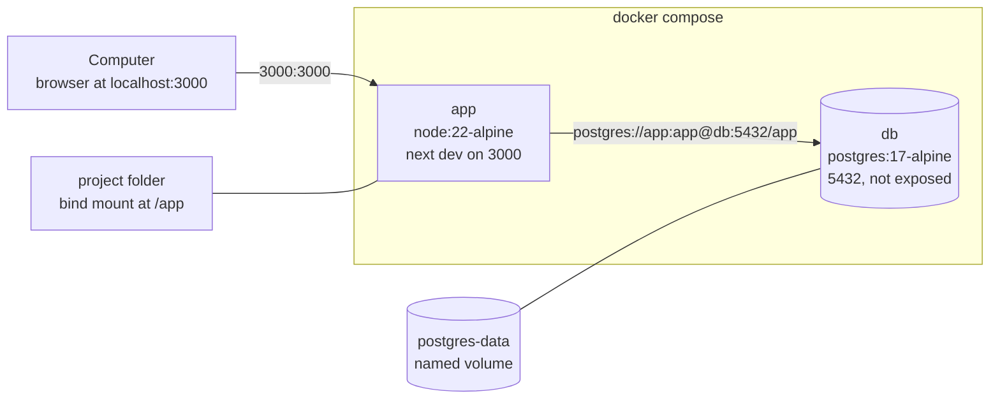
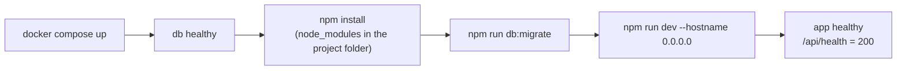

# Runtime and configuration

How the system runs, locally and in CI, and every setting it reads. Everything runs in Docker: the computer only needs Docker, Git and Claude Code, and `docker compose up` works on a fresh clone with no configuration.

## Containers

The diagram shows the services in `docker-compose.yml`, their ports and volumes.

| Service | Image | Ports | Health check | Depends on |
| --- | --- | --- | --- | --- |
| `db` | `postgres:17-alpine` | 5432 inside the network only | `pg_isready` every 5 s | none |
| `app` | `node:22-alpine` | 3000 → 3000 | `GET /api/health` answers 200, every 5 s, up to 5 min after a 30 s start period | `db` healthy |

## Startup

`docker compose up` runs this sequence in the `app` container. The first run downloads the images and installs the dependencies, which takes a few minutes.

`node_modules` is installed by the container into the mounted folder, so editors see the types; it must never be installed from the computer, because native packages are built for the container platform.

## Environment variables

There are two kinds of settings: **local values** the project defines in `docker-compose.yml`, so nothing needs configuring, and **user-provided keys** that only the product owner can supply, in a `.env` file that is never committed and is listed by name in `.env.example`. All application code reads settings through `getServerEnv()` in `src/shared/config/env.ts`, which validates them with zod on first use.

| Variable | Kind | Local value | Read by | Purpose |
| --- | --- | --- | --- | --- |
| `DATABASE_URL` | Local | `postgres://app:app@db:5432/app` | `src/shared/config/env.ts`, `scripts/migrate.mjs` | Application database |
| `TEST_DATABASE_URL` | Local | `postgres://app:app@db:5432/app_test` | `scripts/test-integration.mjs` | Database recreated for integration tests |
| `WATCHPACK_POLLING` | Local | `true` | Next.js | Hot reload on mounted volumes |
| `POSTGRES_USER`, `POSTGRES_PASSWORD`, `POSTGRES_DB` | Local (db service) | `app`, `app`, `app` | Postgres image | Development database credentials |
| `CI` | Set by GitHub Actions | | `docker-compose.yml` | Marks CI runs |

User-provided keys: none in Dev Foundation. `.env.example` is empty; a feature that needs one (for example `OPENAI_API_KEY`) adds the name there, makes it `.optional()` in the schema, and fails only that feature with `UnavailableError` while the key is missing. `npm run check:env` lists missing names, never values. Every local value above is for development only and must be replaced in production.

## Commands

All commands run inside the `app` container with the app running.

| Command | What it does |
| --- | --- |
| `docker compose up` | Starts everything (add `-d --wait` to run in the background until healthy) |
| `docker compose exec -T app npm test` | Unit tests |
| `docker compose exec -T app npm run test:integration` | Integration tests on a fresh `app_test` database |
| `docker compose exec -T app npm run typecheck` | TypeScript check |
| `docker compose exec -T app npm run check:secrets` | Secret scan |
| `docker compose exec -T app npm run check:env` | Missing user-provided keys, by name |
| `docker compose exec -T app npm run db:migrate` | Applies pending migrations |
| `docker compose exec -T app npm run build` | Production build |
| `docker compose exec app npx shadcn@latest add <name>` | Adds a shadcn/ui component to `src/shared/ui/` |
| `docker compose down -v` | Stops everything and erases the database volume |

## Claude Code integration

| File | Purpose |
| --- | --- |
| `.claude/launch.json` | Lets the Claude desktop app start the stack (`docker compose up`, port 3000) and open it in its built-in browser; `autoVerify` is off so browser checks happen at the defined points of the workflow |
| `.mcp.json` | Headless Playwright browser in Docker (`mcr.microsoft.com/playwright/mcp`) for Claude Code in the terminal; it reaches the app at `http://host.docker.internal:3000`, allowed in `next.config.ts` |
| `.claude/settings.json` | Commands Claude may run without asking (tests, checks, compose, git read and commit) and what is denied (reading `.env`, `git push`, `rm -rf`) |

Related: [testing and quality](testing-and-quality.md) · [security](security.md)
