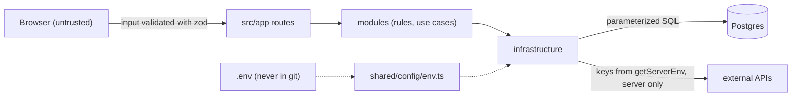

# Security

The threats that matter for this kind of product and the control that handles each one, with where it lives. Reviews use this page together with the `security-reviewer` subagent.

| Threat | Control | Where |
| --- | --- | --- |
| Secrets in the code or in git | Keys only in `.env` (git-ignored), read through `getServerEnv()`; secret scan in CI | `.gitignore`, `src/shared/config/env.ts`, `scripts/check-secrets.mjs`, CI |
| Keys reaching the browser | Client components cannot import server code, config or AI (architecture test); no `NEXT_PUBLIC_` secrets | `src/architecture.test.ts` |
| Leaking internals in errors | Typed errors with safe messages; anything else becomes a generic 500 and only the error name is logged | `src/shared/http/responses.ts` |
| Invalid or malicious input | zod schemas at every boundary (`parseJsonBody`, server actions, URL parsers) | module `application/schemas.ts`, `presentation/url-state.ts` |
| SQL injection | SQL only in repositories, always with `$1`, `$2` parameters | module `infrastructure/` |
| Agent with too much power | Claude Code permissions: tests and checks allowed, `.env` reads, `git push` and `rm -rf` denied; push done by a person | `.claude/settings.json` |
| Prompt injection | Assistant instructions in `system`/`instructions`, user text only in messages; tools call use cases with their own validation | `ai-integration` skill, module `infrastructure/ai/` |
| Abuse of public routes and AI cost | Message size and count limits, agent step limits, rate limiting on public routes | per feature, see [ai](ai.md) |
| Customer data (LGPD) | Keep only what is needed; no message content or personal data in logs or URLs | `CLAUDE.md` rules, [data model](data-model.md) |
| Unsafe dependencies | Exact versions pinned; new packages only with a stated reason; review in pull requests | `package.json`, `code-reviewer` |
| Development credentials in production | Local values in `docker-compose.yml` are development only and must be replaced | [runtime](runtime-and-configuration.md#environment-variables) |

Related: [api](api.md) · [ai](ai.md) · [testing and quality](testing-and-quality.md)
