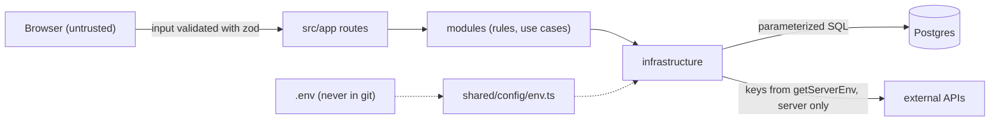

# Security

The threats that matter for this kind of product and the control that handles each one, with where it lives. Reviews use this page together with the `reviewer` subagent.

| Threat | Control | Where |
| --- | --- | --- |
| Secrets in the code or in git | Keys only in `.env` (git-ignored), read through `getServerEnv()`; secret scan in CI | `.gitignore`, `src/shared/config/env.ts`, `scripts/check-secrets.mjs`, CI |
| Keys reaching the browser | Client components cannot import server code, config or AI (architecture test); no `NEXT_PUBLIC_` secrets | `src/architecture.test.ts` |
| Leaking internals in errors | Typed errors with safe messages; anything else becomes a generic 500 and only the error name is logged | `src/shared/http/responses.ts` |
| Invalid or malicious input | zod schemas at every boundary (`parseJsonBody`, server actions, URL parsers) | module `application/schemas.ts`, `presentation/url-state.ts` |
| SQL injection | SQL only in repositories, always with `$1`, `$2` parameters | module `infrastructure/` |
| AI reading data it should not | Tools with typed filters call use cases; the model never writes SQL; visibility and permission rules in the query | module `infrastructure/ai/`, `ai-integration` skill |
| Changing data while inspecting it | `db:query` and `db:explain` accept one read statement, inside a read-only transaction with a timeout, always rolled back | `scripts/db-query.mjs`, CI |
| Agent with too much power | Claude Code permissions: tests and checks allowed, `.env` reads and `rm -rf` denied; `git push` asks for confirmation | `.claude/settings.json` |
| Prompt injection | Assistant instructions in `system`/`instructions`, user text only in messages; tools call use cases with their own validation | `ai-integration` skill, module `infrastructure/ai/` |
| Abuse of public routes and AI cost | Message size and count limits, agent step limits, rate limiting on public routes | per feature, see [ai](ai.md) |
| Customer data (LGPD) | Keep only what is needed; no message content or personal data in logs or URLs | `CLAUDE.md` rules, [data model](data-model.md) |
| Unsafe dependencies | Exact versions pinned; new packages only with a stated reason; review in pull requests | `package.json`, `reviewer` |
| Development credentials in production | Local values in `docker-compose.yml` are development only and must be replaced; logins of people are never local defaults: they come only from `.env` (Docker), the cloud session settings, or the Vercel environment variables (online) | [runtime](runtime-and-configuration.md#environment-variables) |
| Credentials leaking through the AI | Claude cannot read `.env` (`.claude/settings.json`), never asks for or suggests passwords, and the browser test asks the product owner to sign in in the browser pane | `CLAUDE.md`, `test-in-browser` skill |
| Secrets in cloud sessions | The Vercel token is a network secret for `api.vercel.com`: the session holds only the placeholder `vianetworksecret` and the proxy injects the real value. Anthropic hosts cannot be network secrets, so `LLM_API_KEY` is a plain environment variable of the cloud environment holding the real key; Claude never reads, prints or asks for it, and copies it to Vercel through stdin | `scripts/cloud-setup.sh`, [deployment](deployment.md) |
| Local files uploaded to Vercel | `.vercelignore` excludes `.git`, `node_modules`, `.next`, `.vercel` and every `.env` file except `.env.example`; `.vercel/` is git-ignored | `.vercelignore`, `.gitignore` |
| Online secrets and database exposure | Keys copied by Claude from the session to Vercel through stdin as sensitive environment variables, never in a command, log or code; the Neon integration is added with `--no-env-pull` so connection strings never reach the session; Neon connection strings provided by the integration (`DATABASE_URL`, `DATABASE_URL_UNPOOLED`) and never printed; migrations use the direct connection only at build time | [deployment](deployment.md) |

Related: [api](api.md) · [ai](ai.md) · [testing and quality](testing-and-quality.md)
