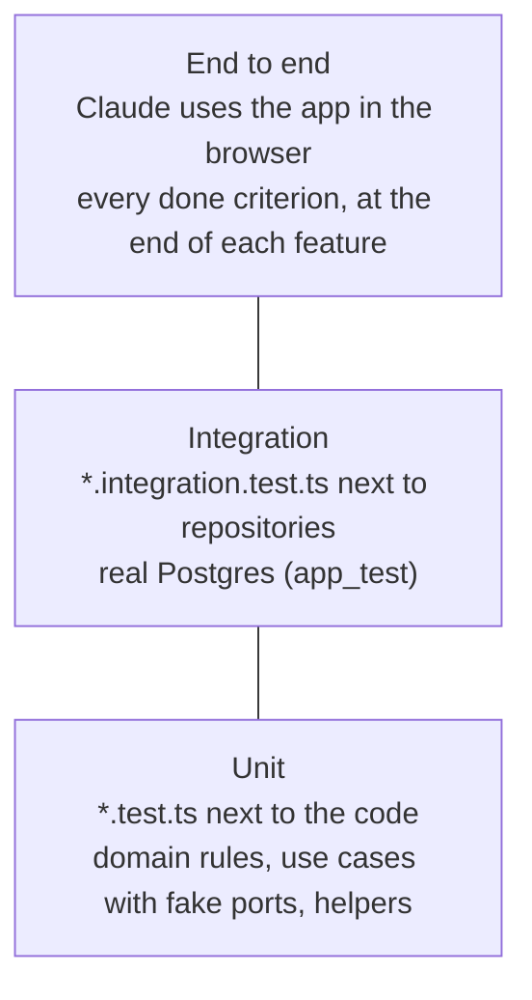
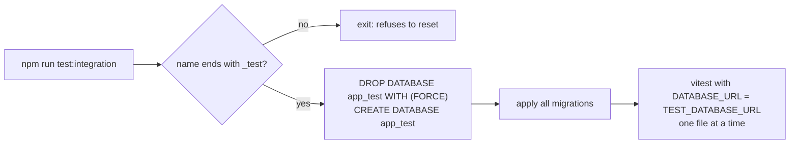
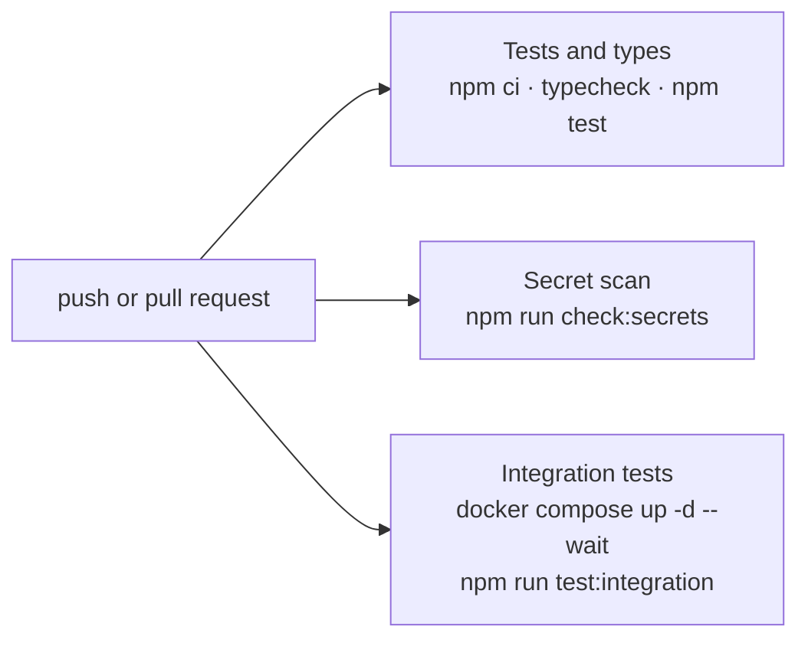
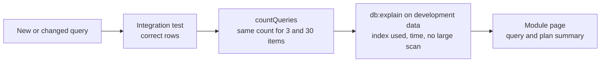

# Testing and quality

How the project proves that changes work and keeps its rules. There are two layers of automated tests in the code and an end-to-end check that Claude performs itself in the browser; CI runs the automated checks on every push and pull request.

## Test layers

| Layer | Proves | Where | Run with | Config |
| --- | --- | --- | --- | --- |
| Unit | Rules and use cases, with fake dependencies; parsers, schemas, scripts | Next to the file, `*.test.ts`; `scripts/*.test.ts` | `docker compose exec -T app npm test` | `vitest.config.ts` |
| Integration | Repositories and adapters against the real database with migrations applied | Next to the file, `*.integration.test.ts`, only in `infrastructure/` or `shared/database/` | `docker compose exec -T app npm run test:integration` | `vitest.integration.config.ts` |
| End to end | The whole product on screen, every done criterion, mobile, URLs, console | Not in the code | `test-in-browser` skill | `.claude/launch.json`, `.mcp.json` |

Unit tests never call external services: AI calls use `MockLanguageModelV4` from `ai/test`. End-to-end checks are not written as test files; the result table goes into the review of the feature.

## Integration test runner

## CI pipeline

`.github/workflows/ci.yml` runs three jobs in parallel on every pull request and on pushes to `main`. A pull request is merged only with the three green.

## Query validation

A query is done when it is proven correct and efficient on realistic data (`database-queries` skill). Three tools cover it:

| Tool | Where | What it shows |
| --- | --- | --- |
| Integration tests | `*.integration.test.ts` next to each repository | The query returns exactly what the use case expects, including filters, sorting, pagination and empty results |
| `countQueries` | `src/shared/database/query-counter.ts`, used inside integration tests | How many queries a function sends through the pool; a list with 3 or 30 items must send the same number (no N+1) |
| `db:query` and `db:explain` | `scripts/db-query.mjs`, run in the app container | The real data and the execution plan of one read statement, with a warning for sequential scans that read 10 000 rows or more; `--force-index` disables sequential scans to prove an index can serve the query |

`db:query` and `db:explain` accept a single `SELECT`, `WITH`, `EXPLAIN`, `SHOW`, `TABLE` or `VALUES` statement, run it inside `BEGIN READ ONLY` with `statement_timeout = 5s`, and always roll back, so they can be used on any database without changing data. CI runs both against the Compose database and checks that a `DELETE` is refused.

## Architecture test

`src/architecture.test.ts` runs with the unit tests. It parses every source file with the TypeScript compiler to read imports and comments and checks the rules listed in [architecture](architecture.md#rules-enforced-by-the-architecture-test): layer dependencies, module boundaries, allowed folders, client and server separation, database and environment access, naming, migrations and the absence of comments in code, CSS, SQL, YAML and `.env.example`.

## Secret scan

`scripts/check-secrets.mjs` scans the files tracked by git or, when the project is not a repository (downloaded as ZIP), every file except `node_modules`, `.git`, `.next` and `.env` files. It looks for OpenAI, Anthropic, AWS, GitHub, Stripe and Slack keys and private keys, and prints file and line for each finding. The same command runs in CI, so a leaked key fails the pull request.

## Current tests

| File | Layer | Covers |
| --- | --- | --- |
| `src/architecture.test.ts` | Unit | Architecture, naming and no-comments rules |
| `src/modules/system-status/domain/system-status.test.ts` | Unit | Status rules |
| `src/modules/system-status/application/use-cases/get-system-status.test.ts` | Unit | Use case with fake probes |
| `src/modules/system-status/infrastructure/postgres-database-probe.integration.test.ts` | Integration | Probe against the real database |
| `src/shared/database/query-counter.integration.test.ts` | Integration | Query counting used to detect N+1 |
| `scripts/db-query.test.ts` | Unit | Read-only statement guard, arguments, row formatting and plan analysis |
| `src/shared/config/env.test.ts` | Unit | Environment validation and error message |
| `src/shared/http/responses.test.ts` | Unit | Body parsing, error mapping, hidden internal errors |
| `src/shared/ai/stream.test.ts` | Unit | Smooth streaming with a mocked model |
| `src/shared/ui/ai/to-chat-panel-messages.test.ts` | Unit | Mapping AI SDK messages to the chat panel |
| `scripts/*.test.ts` | Unit | Migration ordering, secret detection, env check, integration runner |

Related: [architecture](architecture.md) · [runtime and configuration](runtime-and-configuration.md)
