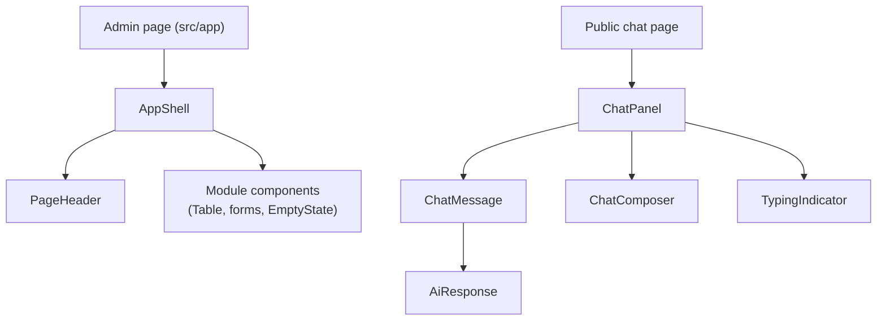

# UI

The visual system: theme, typeface, shared components and layouts, and how screen state lives in the URL. Screens are built from these pieces; the rules for building them are in the `ui-standards` and `url-state` skills.

## Theme

Colors are CSS variables in `src/app/globals.css`, defined for light and dark mode (dark follows the operating system through `prefers-color-scheme`) and exposed to Tailwind with `@theme inline`. Components use only these tokens (`bg-primary`, `text-muted-foreground`), so the brand in `CLAUDE.md` changes the whole UI by editing the variables.

| Token | Used for |
| --- | --- |
| `--background`, `--foreground` | Page surface and text |
| `--card`, `--popover` | Raised surfaces |
| `--primary`, `--primary-foreground`, `--ring` | Brand color: primary actions, active navigation, focus |
| `--secondary`, `--muted`, `--accent` | Quiet surfaces, secondary text, hover and selection |
| `--destructive` | Errors and destructive actions |
| `--border`, `--input` | Lines and fields |
| `--sidebar`, `--sidebar-foreground` | `AppShell` navigation |
| `--radius` | Corner radius scale (`rounded-sm` to `rounded-xl`) |

Typeface: Instrument Sans (variable), self-hosted from `@fontsource-variable/instrument-sans`. Animations are removed for users who prefer reduced motion.

## Components

| Group | Components | Where |
| --- | --- | --- |
| Primitives (shadcn/ui) | `Button`, `Input`, `Textarea`, `Label`, `Card`, `Badge`, `Table`, `Skeleton` | `src/shared/ui/` |
| Layouts | `AppShell` (sidebar on desktop, top bar on mobile, active item from the path), `PageHeader` (title, description, actions), `EmptyState` | `src/shared/ui/layout/` |
| AI | `ChatPanel`, `ChatComposer`, `ChatMessage`, `AiResponse`, `TypingIndicator` | `src/shared/ui/ai/` |

New shadcn/ui components are added with `docker compose exec app npx shadcn@latest add <name>` and land in `src/shared/ui/` (`components.json`).

## Screen states

Every screen handles loading (`Skeleton` shaped like the content), empty (`EmptyState`), error (plain message and a way to retry) and success.

## URL state

Every visible state of a screen (resource, filters, search, sort, page, tab, selection, dialog, step) is in the URL, with nuqs. `NuqsAdapter` wraps the app in `src/app/layout.tsx`; each module defines its parsers once in `presentation/url-state.ts`, read on the server with `createLoader` and changed on the client with `useQueryStates`. Defaults are left out of the URL, invalid values fall back to the default, and paths and parameters are in English.

| Module | Page | Parameters |
| --- | --- | --- |
| none yet | | |

Related: [ai](ai.md) · [api](api.md)
